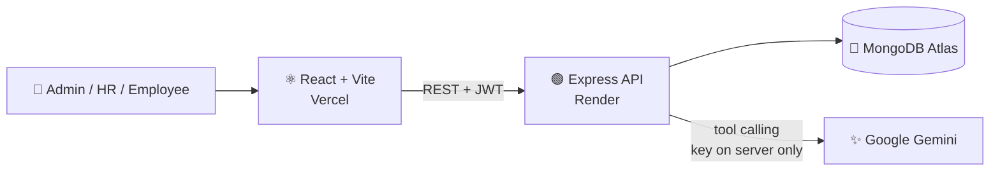
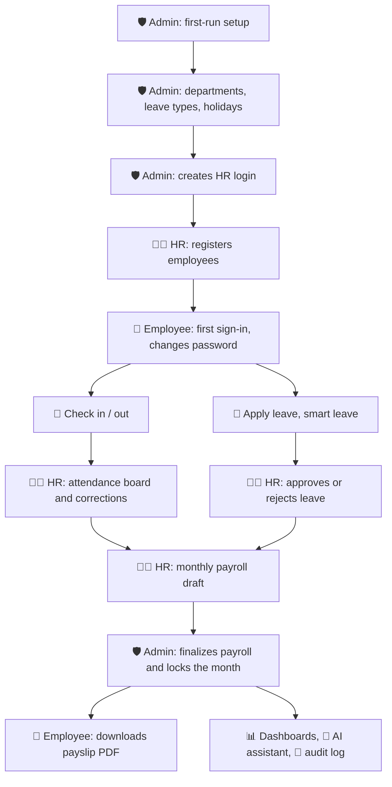

<div align="center">

# 🏢 HCM Lite

### AI-assisted Human Capital Management for Admin, HR and Employees

*Built for the **Saylani Hackathon** · 24 October 2026 · Zaitoon Ashraf IT Park*


**[🌐 Live Demo](https://YOUR-APP.vercel.app)** &nbsp;·&nbsp; **[📦 Repository](https://github.com/YOUR-USERNAME/hcm-lite)** &nbsp;·&nbsp; **[🎬 5-Minute Demo Script](#-5-minute-demo-script)**

</div>

---

## 📑 Table of Contents

- [Overview](#-overview)
- [Features by Role](#-features-by-role)
- [How It Works](#-how-it-works)
- [Tech Stack](#-tech-stack)
- [Project Structure](#-project-structure)
- [Getting Started](#-getting-started)
- [Environment Variables](#-environment-variables)
- [Deployment](#-deployment-free-tier)
- [AI Assistant](#-ai-assistant)
- [Business Rules](#-business-rules)
- [Security](#-security)
- [API Reference](#-api-reference)
- [Testing](#-testing)
- [5-Minute Demo Script](#-5-minute-demo-script)
- [Done / Not Done](#-done--not-done)
- [Judges' Verification Prompts](#-judges-verification-prompts)

---

## ✨ Overview

**HCM Lite** is a full-stack HR system for the daily work of an HR team, with an **AI assistant that answers questions from real data**.

> 🧼 **There is no pre-loaded or dummy data.** The system starts empty. Admin sets up the company, HR registers employees, and every number on every dashboard comes from what people actually do in the app.

| | |
|---|---|
| 👥 **Roles** | Admin · HR · Employee, each with its own menu, data scope and dashboard |
| 🧩 **Modules** | Auth, Org Setup, Employees, Attendance, Leave, Payroll, Dashboards, AI Assistant, Comms & Audit |
| 🔐 **Access control** | Enforced on the **server** for every request, never only in the UI |
| 🤖 **AI** | Google Gemini with tool calling; the database is the only source of truth |
| 🌍 **Timezone** | All dates and times are evaluated in **Asia/Karachi** |

---

## 👥 Features by Role

<table>
<tr>
<th width="33%">🛡️ Admin</th>
<th width="33%">🧑‍💼 HR</th>
<th width="33%">🙋 Employee</th>
</tr>
<tr valign="top">
<td>

- Company setup, office hours, grace time, weekend, office location
- Departments, designations, leave types, quotas, holidays
- Create, deactivate and reset HR logins
- View every employee, attendance, leave and payroll record
- **Finalize payroll** (locks the month)
- Company dashboard and AI briefing
- Audit log of every important action
- Post announcements

</td>
<td>

- Register employees (creates their login)
- Edit employee details, set salary structures
- Attendance board, approve or reject corrections
- Approve or reject leave with a comment
- Create and review the monthly payroll draft
- HR dashboard and AI summary
- Post announcements

</td>
<td>

- Web check-in / check-out
- Attendance calendar, request corrections
- Apply or cancel leave, see balance
- **Smart leave:** describe it in words, get a pre-filled form
- Download own payslips (PDF)
- Personal dashboard
- AI assistant on own data and company policy
- Edit own phone and address

</td>
</tr>
<tr valign="top">
<td>

❌ Cannot edit a finalized payroll or touch audit entries

</td>
<td>

❌ Cannot change company settings, create Admins, finalize payroll or view the audit log

</td>
<td>

❌ Cannot see anyone else's data or salary, approve anything, or edit own salary, role or attendance

</td>
</tr>
</table>

---

## 🔄 How It Works

### Architecture



### End-to-end flow



> Rules set in **Org Setup** decide attendance and leave status. Attendance and unpaid leave decide **payroll** deductions. **Dashboards** aggregate all of it, and the **AI assistant** calls the same services, so its answers always match the dashboards.

---

## 🧰 Tech Stack

| Layer | Technology |
|---|---|
| **Server** | Node.js (CommonJS), Express 4, Mongoose 8, Zod |
| **Auth** | JWT (Bearer token), bcryptjs |
| **Security** | Helmet, CORS, express-rate-limit |
| **PDF** | pdfkit (streamed on the fly, never saved to disk) |
| **AI** | Google Gemini via the official SDK (`@google/generative-ai`) |
| **Testing** | Jest, Supertest, mongodb-memory-server |
| **Client** | React 18, Vite 5, Tailwind CSS 3, React Router 6 |
| **UI** | Radix UI primitives, Lucide icons, Recharts |
| **HTTP** | Axios (auto token injection and 401 handling) |
| **Hosting (free)** | MongoDB Atlas M0 · Render · Vercel |

---

## 🗂️ Project Structure

```text
hcm-lite/
├── server/
│   └── src/
│       ├── app.js · server.js          Express app and entry point
│       ├── config/                     env.js, db.js
│       ├── middleware/                 authenticate, requireRole, scopeFilter, validate, errorHandler, rateLimit
│       ├── models/                     User, Settings, Employee, Attendance, LeaveRequest, PayrollRun, Payslip,
│       │                               Announcement, Notification, AuditLog, AiLog ...
│       ├── utils/                      httpError, password, token, audit, notify, time
│       ├── modules/
│       │   ├── setup/                  First-run setup + env bootstrap
│       │   ├── auth/                   Login, me, change-password, logout
│       │   ├── settings/ · org/        Company config, departments, designations, leave types, holidays
│       │   ├── users/ · audit/         HR user management, append-only audit log
│       │   ├── employees/              Registration, directory, Employee 360, CSV export
│       │   ├── attendance/ · leave/    Check-in/out, corrections, leave workflow
│       │   ├── payroll/                Salary structure, runs, tax, payslip PDF
│       │   ├── dashboards/             Admin / HR / Employee KPIs
│       │   ├── announcements/ · notifications/
│       │   └── ai/                     Chat, summary, smart leave, tools, prompts
│       └── tests/
└── client/
    └── src/
        ├── context/                    AuthContext
        ├── lib/                        api.js, utils.js
        ├── components/                 layout/ (Sidebar, Topbar, ProtectedRoute), shared/ (Loader, EmptyState ...)
        └── features/                   setup, auth, dashboard, settings, org, users, audit,
                                        employees, attendance, leave, payroll, announcements, notifications, ai
```

Business rules live **only in services**. Controllers parse, validate, call a service and respond.

---

## 🚀 Getting Started

### Prerequisites

- Node.js 18+
- A MongoDB Atlas cluster (or a local MongoDB)
- A Google Gemini API key (free from [Google AI Studio](https://aistudio.google.com/)) for the AI features

### 1. Server

```bash
cd server
cp .env.example .env      # then fill in MONGO_URI, JWT_SECRET, AI_API_KEY
npm install
npm run dev               # http://localhost:5000  (nodemon)
```

### 2. Client (new terminal)

```bash
cd client
cp .env.example .env      # VITE_API_URL=http://localhost:5000/api
npm install
npm run dev               # http://localhost:5173
```

### 3. Create the first Admin

**Option A: Setup page (recommended).** Open `http://localhost:5173`. With no Admin in the database you are redirected to `/setup`. Enter the company name and the Admin account.

**Option B: environment variables.** Set these in `server/.env` before starting the server and the Admin is created on boot:

```env
ADMIN_EMAIL=admin@yourcompany.com
ADMIN_PASSWORD=YourSecurePassword
COMPANY_NAME=Your Company
```

After that, Admin creates HR logins, and HR registering an employee creates that employee's login with a **temporary password that must be changed on first sign-in**.

---

## 🔑 Environment Variables

### Server (`server/.env`)

| Variable | Required | Description |
|---|:---:|---|
| `MONGO_URI` | ✅ | MongoDB connection string |
| `JWT_SECRET` | ✅ | Long random string used to sign tokens |
| `JWT_EXPIRES_IN` | | Token lifetime (default `7d`) |
| `CLIENT_URL` | | Allowed CORS origin (default `http://localhost:5173`) |
| `PORT` | | Server port (default `5000`) |
| `ADMIN_EMAIL` · `ADMIN_PASSWORD` | | Bootstrap the first Admin on boot |
| `COMPANY_NAME` | | Company name for env bootstrap (default `My Company`) |
| `AI_API_KEY` | | Gemini API key. Read by the server only, never sent to the browser |
| `AI_MODEL` | | Gemini model name (default `gemini-1.5-flash`). If it is unavailable for your account, copy a current model name from Google AI Studio |
| `NODE_ENV` | | Set to `production` when deployed |

### Client (`client/.env`)

| Variable | Required | Description |
|---|:---:|---|
| `VITE_API_URL` | ✅ | Backend base URL, e.g. `http://localhost:5000/api` or `https://your-api.onrender.com/api` |

> 🔒 Commit `.env.example` only. Never commit a real key, password or database URI.

---

## ☁️ Deployment (free tier)

<details>
<summary><b>1️⃣ Database: MongoDB Atlas M0</b></summary>

1. Create a free **M0** cluster at [cloud.mongodb.com](https://cloud.mongodb.com).
2. **Database Access:** create a user (use a password without `@ : / ? #`).
3. **Network Access:** allow `0.0.0.0/0` so the Render service can connect.
4. Copy the connection string and add a database name, e.g. `.../hcm-lite-prod?retryWrites=true&w=majority`.

The database and its collections are created automatically the first time the app writes data.

</details>

<details>
<summary><b>2️⃣ Backend: Render</b></summary>

1. **New → Web Service**, connect your GitHub repo.
2. Settings:

| Field | Value |
|---|---|
| Root Directory | `server` |
| Build Command | `npm install` |
| Start Command | `npm start` |
| Instance Type | Free |

3. Add the environment variables: `MONGO_URI`, `JWT_SECRET`, `CLIENT_URL` (your Vercel URL), `AI_API_KEY`, `NODE_ENV=production`.
4. Do **not** set `ADMIN_EMAIL` / `ADMIN_PASSWORD` if you want the hosted app to start from the first-run setup page.
5. Check `https://<your-service>.onrender.com/api/health`.

> ⏱️ The Render free tier sleeps after 15 minutes of inactivity. The first request afterwards can take about a minute. Open the health URL shortly before a demo to wake it up.

</details>

<details>
<summary><b>3️⃣ Frontend: Vercel</b></summary>

1. Import the repo on [vercel.com](https://vercel.com).
2. Root Directory: `client`. Framework: Vite.
3. Add `VITE_API_URL` = `https://<your-service>.onrender.com/api`.
4. `client/vercel.json` already handles SPA routing.
5. Go back to Render and set `CLIENT_URL` to the final Vercel URL (no trailing slash).

</details>

---

## 🤖 AI Assistant

A role-aware, **read-only** assistant powered by Google Gemini. The browser never talks to the AI provider: every call goes through authenticated backend endpoints, and every answer carries an **AI-generated** label.

### Guarantees

| | Guarantee |
|---|---|
| 🔒 | **Read-only.** The AI never creates, edits, approves or deletes anything. Smart leave only pre-fills a form; the user confirms. |
| 🪪 | **Identity from the JWT.** For Employees the server forces their own `employeeId`, ignoring anything the model sends. |
| 🙈 | **Salary privacy.** Colleague salaries are never revealed; payroll tools are limited by role at execution time. |
| 🛡️ | **Prompt-injection defense.** Tool output is treated as untrusted data, never as instructions. |
| ⏱️ | **Limits.** 15 s timeout, one retry for transient errors, about 20 requests per user per hour (HTTP 429 with `retryAfterMinutes`). |
| 🧯 | **Graceful fallback.** If the AI is down or the key is missing, the app keeps working and returns a friendly message with `fallback: true`. |
| 📒 | **Audit.** Every call is logged in `ai_logs` (user, role, feature, tools called, latency, status). |
| 📜 | **Live policy.** Company rules and quotas are loaded from the current Settings and Leave Types on every request. |
| 🌐 | **Multilingual.** Understands English, Urdu and Roman Urdu. |

### Features

| Feature | Who | What it does |
|---|---|---|
| 💬 **Chat** | All roles | Picks a tool, the backend runs it with the user's scope, the model writes the answer |
| 📝 **Dashboard summary** | Admin, HR | 3 to 5 insight bullets using only the numbers on the dashboard |
| 🗓️ **Smart leave** | Employee | "Need next Monday and Tuesday off for a wedding" becomes a pre-filled leave form |
| 📖 **Policy Q&A** | All roles | Answers only from the company rules, or says it does not know |

### Tools (function calling)

| Tool | Allowed roles | Backed by |
|---|---|---|
| `get_headcount` | Admin, HR | Employees and HR dashboard services |
| `get_attendance_summary` | Admin, HR | `getAttendanceSummary` |
| `get_late_comers` | Admin, HR | `getLateComers` |
| `get_leave_summary` | Admin, HR | `getLeaveSummary` |
| `get_my_leave_balance` | Employee | `getLeaveBalance` (own record only) |
| `get_payroll_summary` | Admin | `getPayrollSummary` |
| `search_employees` | Admin, HR | `listEmployees` |

Tools call the **same services** as the REST API and dashboards, so AI numbers always match what the dashboards show.

---

## 📐 Business Rules

<details open>
<summary><b>⏰ Attendance</b></summary>

- Office start **09:00**, grace **15 min**: late after **09:15**
- **Half day** when worked time is under **5 hours**
- Weekend: **Saturday and Sunday**
- One record per employee per day (a second check-in returns `409`)
- **Absent**: no record and no approved leave. **Missing checkout**: checked in, never checked out
- The server stamps the time. The client can never send it

</details>

<details>
<summary><b>🌴 Leave</b></summary>

- Only **working days** count (weekends and public holidays are skipped)
- Default quotas: **Annual 14 · Sick 8 · Casual 10 · Unpaid unlimited**
- Overlap or over-balance returns `422`
- Only HR approves or rejects, and a comment is required on rejection

</details>

<details>
<summary><b>💰 Payroll</b></summary>

| Item | Formula |
|---|---|
| Gross | `basic + HRA (40%) + medical (10%) + other` (by default 1.5 × basic) |
| Per day | `gross ÷ working days` |
| Deduction days | `absent + unpaid leave + 0.5 × half days` |
| Proration | Joiners and leavers are prorated by eligible working days |
| Net pay | `earned gross − deduction − monthly tax` (never below 0) |

**Tax slab** (illustrative), applied to `gross × 12`:

| Annual gross (PKR) | Annual tax |
|---|---|
| up to 600,000 | 0 |
| 600,001 to 1,200,000 | 5% of the amount above 600,000 |
| 1,200,001 to 2,400,000 | 30,000 + 15% of the amount above 1,200,000 |
| 2,400,001 to 3,600,000 | 210,000 + 25% of the amount above 2,400,000 |
| above 3,600,000 | 510,000 + 35% of the amount above 3,600,000 |

HR creates the draft, **only Admin can finalize**, and a finalized run is **locked**. Payslips store a full snapshot, so later salary changes never alter history. PDFs are generated on the fly.

</details>

<details>
<summary><b>📊 Dashboard metrics</b></summary>

| Metric | Formula |
|---|---|
| Headcount | Active + probation on the end date |
| Attrition % | Exits in period ÷ average headcount × 100 |
| Attendance rate | `(present + late + missing_checkout + 0.5 × half_day) ÷ (working-day records − on_leave)` |
| Late % | `late ÷ (present + late)` |
| Absenteeism % | Absent days ÷ expected working days, per department |
| Leave utilization | Approved days per leave type |
| Payroll cost | Gross and net from **finalized** runs, by month and department |

When a denominator is 0 the value is `null`, never `NaN`.

</details>

---

## 🔐 Security

- 🧂 Passwords hashed with **bcrypt**; password hashes are never returned by any endpoint
- 🪙 **JWT** auth, with every API checking **role and data scope** on the server
- 🔁 `mustChangePassword` is enforced server-side, not only in the UI
- 🚫 The API can never create another Admin; `/api/users` only creates HR logins
- 🌐 **CORS** restricted to `CLIENT_URL`, **Helmet** headers, login rate limit (15 requests per 15 minutes per IP)
- 📒 **Append-only audit log** with actor, action, entity and before/after JSON; no update or delete routes
- 🔑 AI key only in a server environment variable, never in the browser or the repo
- 🧱 Finalized payroll is locked and cannot be edited or deleted

---

## 📡 API Reference

All routes are prefixed with `/api`. Errors always use `{ "error": { "code", "message", "fields?" } }`. Status codes: `401` not logged in · `403` forbidden · `409` conflict · `422` validation or business rule.

Full route lists for each module are in `server/src/modules/<module>/routes.js`.

<details>
<summary><b>Setup, Auth, Settings, Org, Users, Audit</b></summary>

| Method | Path | Access | Description |
|---|---|---|---|
| GET | `/health` | Public | Health check |
| GET | `/setup/status` | Public | `{ initialized }` |
| POST | `/setup` | Public | First-run setup (`409` once initialized) |
| POST | `/auth/login` | Public | Login, returns a JWT |
| GET | `/auth/me` | Any user | Current user |
| POST | `/auth/change-password` | Any user | Change password |
| POST | `/auth/logout` | Any user | Logout |
| GET / PUT | `/settings` | Admin, HR / Admin | Read / update company settings |
| GET, POST, PUT | `/org/departments`, `/org/designations`, `/org/leave-types` | Admin, HR read / Admin write | Org setup (toggle `isActive`, no hard delete) |
| GET, POST, DELETE | `/org/holidays` | Admin, HR read / Admin write | Public holidays |
| GET, POST | `/users` | Admin | List / create HR login (temporary password returned once) |
| PATCH | `/users/:id/activate` · `/deactivate` | Admin | Enable / disable a login |
| POST | `/users/:id/reset-password` | Admin | New temporary password |
| GET | `/audit` | Admin | Paginated audit log |

</details>

<details>
<summary><b>Employees</b></summary>

| Method | Path | Access | Description |
|---|---|---|---|
| POST | `/employees` | HR | Register employee and linked login in one flow |
| GET | `/employees` | All (Employee sees only self) | Directory with search, filters, paging |
| GET | `/employees/export` | HR | CSV export of the current filters |
| GET | `/employees/:id` | Admin, HR, self | Employee 360 profile |
| PUT | `/employees/:id` | HR | Update details and status (`exited` needs `exitDate` and disables the login) |
| PATCH | `/employees/me` | Employee | Update own phone and address only |

`basicSalary` is only returned to Admin, HR, or the employee viewing their own record.

</details>

<details>
<summary><b>Attendance and Leave</b></summary>

| Method | Path | Access | Description |
|---|---|---|---|
| POST | `/attendance/check-in` | Employee | Server-stamped check-in |
| POST | `/attendance/check-out` | Employee | Check-out, computes worked hours |
| GET | `/attendance/me?month=YYYY-MM` | Employee | Own monthly calendar |
| GET | `/attendance/board?date=YYYY-MM-DD` | HR, Admin | Daily board for every employee |
| POST | `/attendance/corrections` | Employee | Request a correction |
| GET | `/attendance/corrections` | All (scoped) | Corrections inbox |
| PATCH | `/attendance/corrections/:id/decision` | HR | Approve or reject |
| GET | `/leave/preview` | Employee | Working days and balance, nothing saved |
| GET | `/leave/balance` | All (scoped) | Quota, used, pending, remaining per type |
| POST | `/leave` | Employee | Apply (`422` on overlap or over-balance) |
| GET | `/leave/my` · `/leave` | Employee / HR, Admin | Own history / all requests |
| PATCH | `/leave/:id/cancel` | Employee | Cancel own request |
| PATCH | `/leave/:id/decision` | HR | Approve or reject with a comment |

</details>

<details>
<summary><b>AI</b></summary>

| Method | Path | Access | Description |
|---|---|---|---|
| POST | `/ai/chat` | All | Role-scoped chat with tool calling |
| POST | `/ai/summary` | Admin, HR | 3 to 5 bullet KPI summary |
| POST | `/ai/smart-leave` | Employee | Text to pre-filled leave form (never saves) |

```jsonc
// POST /api/ai/chat
{ "message": "Who came late most often this month?", "history": [] }
// → { "message": "...", "toolsCalled": ["get_late_comers"], "fallback": false }
```

</details>

---

## 🧪 Testing

```bash
cd server
npm test
```

Tests use `mongodb-memory-server` and a mocked LLM, so **no real database and no AI key are needed** to run them.

---

## 🎬 5-Minute Demo Script

Start from a **fresh install**.

| # | Who | Step |
|:-:|---|---|
| 1 | 🛡️ Admin | Complete `/setup`. Add office hours and location, a department, and leave types (Annual 14, Casual 10, Sick 8). Create an **HR login** |
| 2 | 🧑‍💼 HR | Sign in, change the password. Register two or three employees (e.g. basic salary 100000) |
| 3 | 🙋 Employee | Sign in with the temporary password, change it, **check in** |
| 4 | 🙋 Employee | Open *Apply leave*, type: *"I need next Thursday off for my cousin's wedding"*, click **Fill the form**, review and submit |
| 5 | 🧑‍💼 HR | Approve the leave. Open the dashboard, click **Summarize**, then ask the assistant *"Who is on leave today?"* |
| 6 | 🧑‍💼 HR | Create the monthly **payroll draft** |
| 7 | 🛡️ Admin | **Finalize** the payroll (the month is locked) |
| 8 | 🙋 Employee | Download the **payslip PDF**, then ask *"What is my colleague's salary?"* and watch it get **refused** |
| 9 | 🛡️ Admin | Open the **Audit log** |

---

## ✅ Done / Not Done

| # | Functionality | Status |
|:-:|---|:-:|
| 1 | First-run setup and company profile | ✅ |
| 2 | Login, logout, change password, role-based menus | ✅ |
| 3 | Company settings (hours, grace, weekend, location) | ✅ |
| 4 | Departments, designations, leave types, holidays | ✅ |
| 5 | Create HR logins, deactivate and reset | ✅ |
| 6 | Register employee (creates login) and edit details | ✅ |
| 7 | Directory with search, filters, Employee 360 | ✅ |
| 8 | CSV export | ✅ |
| 9 | Web check-in and check-out | ✅ |
| 10 | Attendance calendar and daily board | ✅ |
| 11 | Attendance corrections (request and approve) | ✅ |
| 12 | Apply and cancel leave, balance, history | ✅ |
| 13 | Approve or reject leave with a comment | ✅ |
| 14 | Salary structure per employee | ✅ |
| 15 | Monthly payroll draft and review | ✅ |
| 16 | Finalize payroll (locks the month) | ✅ |
| 17 | Payslips with PDF download | ✅ |
| 18 | Dashboards, KPIs, trends, filters | ✅ |
| 19 | AI assistant chat | ✅ |
| 20 | AI dashboard summary | ✅ |
| 21 | Smart leave | ✅ |
| 22 | Policy Q&A | ✅ |
| 23 | Announcements | ✅ |
| 24 | In-app notifications | ✅ |
| 25 | Audit log | ✅ |
| — | CSV import with dry run | ❌ Not done |
| — | Camera attendance and face detection | ❌ Not done |
| — | Other bonuses (attrition risk score, anomaly flags, late penalty rule, dark mode / PWA) | ❌ Not done |

---

## 🧑‍⚖️ Judges' Verification Prompts

| As | Prompt | Expected |
|---|---|---|
| 🧑‍💼 HR | *How many active employees are in Engineering?* | Same number as the directory and dashboard |
| 🧑‍💼 HR | *Who came late most often this month?* | Matches the Top 5 late-comers card |
| 🧑‍💼 HR | *What is this month's attendance rate?* | Matches the dashboard KPI |
| 🙋 Employee | *How many sick leaves do I have left this year?* | Own balance after approved leaves |
| 🙋 Employee | *What is Alice's salary?* | Politely refused, no tool called |
| 🙋 Employee | *I need next Monday and Tuesday off for my sister's wedding* | Pre-filled casual leave with the correct dates |
| 🛡️ Admin | *What is our total payroll cost this month?* | Gross and net from finalized runs |
| 🌐 Any | *Hamari company mein kitnay active employees hain?* | Answer in Roman Urdu or English |
| ⚙️ Any | Unset `AI_API_KEY` and ask anything | Friendly fallback message, the rest of the app keeps working |

---

<div align="center">

**Built with ❤️ for the Saylani Hackathon**

*Saylani IT Training · Changing Lives, Building Careers, Shaping the Future*

</div>
